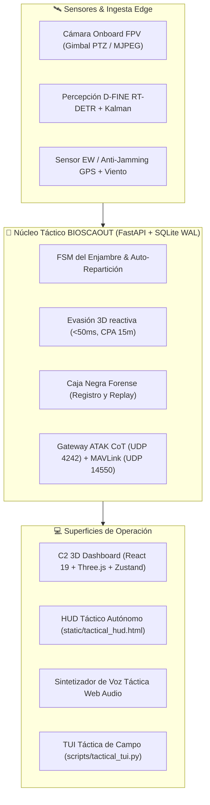

<div align="center">

# 🚁 BIOSCAOUT — Bio-Autonomous Swarm Command & Control
### Plataforma Edge de Gestión y Orquestación Autónoma de Enjambres de Drones SAR en la Hora Dorada (&lt;60 min)

[](#)
[](#)
[](#)
[](#)
[](#)
[](#)

```text
  ██████╗ ██╗ ██████╗ ███████╗ ██████╗ █████╗  ██████╗ ██╗   ██╗████████╗
  ██╔══██╗██║██╔═══██╗██╔════╝██╔════╝██╔══██╗██╔═══██╗██║   ██║╚══██╔══╝
  ██████╔╝██║██║   ██║███████╗██║     ███████║██║   ██║██║   ██║   ██║   
  ██╔══██╗██║██║   ██║╚════██║██║     ██╔══██║██║   ██║██║   ██║   ██║   
  ██████╔╝██║╚██████╔╝███████║╚██████╗██║  ██║╚██████╔╝╚██████╔╝   ██║   
  ╚═════╝ ╚═╝ ╚═════╝ ╚══════╝ ╚═════╝╚═╝  ╚═╝ ╚═════╝  ╚═════╝    ╚═╝   
             BIO-AUTONOMOUS SWARM COMMAND & CONTROL (SAR C2)
```

<p align="center">
  <b>Percepción D-FINE (RT-DETR) • Seguimiento Kalman • Evasión Reactiva 3D &lt;50ms • Enjambre Autocurativo • Voz Táctica • Telemetría 20Hz</b>
</p>

[📋 Especificación](./specs/spec.md) • [🧪 Infraestructura de Pruebas](./TEST_INFRA.md) • [📁 Plan del Proyecto](./PROJECT.md)

</div>

---

> [!NOTE]
> **BIOSCAOUT** es el nuevo nombre del proyecto antes conocido como **ARES (Autonomous Rescue Emergency System)**. Algunos identificadores internos conservan el nombre histórico: paquete Python `proyectocompe`, IDs de dron (`ARES-01`, `ARES-02`, `ARES-03`), misión de ejemplo `ARES-MISSION-01`, contenedores Docker y URL del repositorio.

---

## 🎨 Sistema de Diseño, Logos y Animaciones

La plataforma cuenta con un sistema de diseño visual táctico de alto contraste optimizado para campo y operaciones diurnas/nocturnas:
* **4 Modos Visuales Militares:** `Dark HUD` (base #060911), `Modo Luz Diurno` (#f1f5f9), `NVG Fósforo Verde` (hue-rotate) y `Amber FLIR Infrarrojo` (termografía sepia).
* **12+ Animaciones Tácticas:** Flotación continua de drones (`float`), respiración de telemetría viva a 20 Hz (`breathe`), resplandor de caja negra REC (`redGlowPulse`), pulso cian de radar (`pulseGlow`), onda expansiva de supervivientes (`subtlePulse`) y transiciones elásticas (`slideUpFade`).
* **Iconografía e Insignias:** Emblema de rescate, cruz médica SAR ✚, silueta de cuadricóptero UAV y paleta de alta visibilidad `rescue` (50–950).

---

## 🗺️ Arquitectura Integral del Sistema



---

## ⚡ Aplicaciones del Repositorio

El repositorio provee dos aplicaciones FastAPI independientes:

| Aplicación | Entrypoint | Puerto | Propósito |
| :--- | :--- | :---: | :--- |
| **Tactical Swarm C2** | `proyectocompe.main:app` (`--app-dir src`) | `8000` | Centro de mando de enjambre: 3D Three.js, radar 2D, telemetría WebSocket 20Hz, defensa EW, AAR, ATAK y MAVLink. |
| **Edge Core** | `src.api.main:app` | `8000` | API de planificación de misiones con JWT, reglas de la Hora Dorada, carga útil y dashboard HTML local. |

---

## 🚀 Inicio Rápido: Tactical Swarm C2

<details open>
<summary><b>1. Pasos de Ejecución Local (uv o pip)</b></summary>

```bash
# 1. Instalar dependencias Python
uv sync                      # o: python -m pip install -r requirements.txt

# 2. Compilar el frontend (opcional: dist/ ya incluye un build funcional)
cd frontend
npm ci
npm run build
cd ..

# 3. Iniciar el Servidor C2
uv run uvicorn proyectocompe.main:app --app-dir src --host 127.0.0.1 --port 8000 --reload
```

Una vez levantado:
* **Centro de Mando C2 (React 3D):** <http://127.0.0.1:8000/>
* **HUD Táctico de Emergencia:** <http://127.0.0.1:8000/hud>
* **Cámara Móvil de Transmisión:** <http://127.0.0.1:8000/mobile-cam>
* **Documentación Interactiva Swagger:** <http://127.0.0.1:8000/docs>
* **Telemetría WebSocket:** `ws://127.0.0.1:8000/ws/telemetry`

</details>

<details>
<summary><b>2. Despliegue con Docker Compose</b></summary>

```bash
docker compose up --build
```

El contenedor expone:
* `8000/tcp`: API REST, WebSockets y Frontend
* `14550/udp`: Gateway MAVLink v1/v2
* `4242/udp`: Gateway ATAK Cursor-on-Target (CoT)

</details>

---

## 🛠️ Matriz de Endpoints REST (`/api/v1`)

<details>
<summary><b>Ver Tabla Completa de Endpoints Tácticos (Click para expandir)</b></summary>

| Prefijo | Funciones Principales |
| :--- | :--- |
| `/drones` | Telemetría en vivo, FSM de drones, órdenes `takeoff`, `rth`, `land`, `goto` y formaciones. |
| `/missions` | Generación de rejillas boustrophedon, cálculo de cobertura, informes AAR y exportación QGroundControl. |
| `/detections` | Ingesta de visión artificial D-FINE, clustering geográfico (&lt;8m), snapshots y exportación GeoJSON. |
| `/geofences` | Definición de límites operacionales y zonas de exclusión dinámica (NFZ). |
| `/camera` | Streaming MJPEG de bajo retardo, control de gimbal PTZ, presets (`nadir`, `patrol`, `horizon`) y capturas. |
| `/telemetry` | Ingesta externa y simulador MAVLink para pruebas PX4/ArduPilot. |
| `/defense` | Watchdog anti-jamming GPS, análisis de viento y punto de no retorno (PNR). |
| `/recorder` | Grabación de Caja Negra en disco y reproductor de sesiones tácticas con velocidad variable. |
| `/chaos` | Suite de ingeniería del caos: inyección de fallos, caída de batería y ráfaga de detecciones. |
| `/ai-engine` | Monitor de salud de GPU, framerate de inferencia y consumo de VRAM. |

</details>

---

## 🧪 Pruebas Automatizadas y Benchmark

```bash
# Ejecutar todas las pruebas unitarias y de integración
uv run pytest

# Ejecutar suite de pruebas de extremo a extremo (E2E)
uv run pytest tests/e2e

# Demostración del benchmark cinemático y de visión
python demo_test.py
```

---

## 📜 Estructura del Repositorio

```text
├── src/
│   ├── ai/                  # D-FINE, visión, estimación Kalman, evasión 3D
│   ├── api/                 # Edge Core: FastAPI, JWT y reglas de dominio
│   ├── core/                # Modelos Pydantic, FSM y validadores
│   ├── database/            # Esquema SQLite (WAL), migraciones y seeders
│   └── proyectocompe/       # Tactical Swarm C2 (FastAPI, WebSockets, Servicios C2)
├── frontend/                # React 19 + TypeScript + Three.js + Tailwind + Zustand
├── dist/                    # Build estático listo para distribución
├── static/                  # HUD táctico y cámara web móvil autónomos
├── weights/                 # Checkpoints neuronales D-FINE (RT-DETR)
├── configs/                 # Configuraciones YAML de visión y datasets
├── scripts/                 # Demos guiadas para jueces y simuladores
├── specs/                   # Especificación técnica formal
└── tests/                   # Suite de pruebas automatizadas
```
